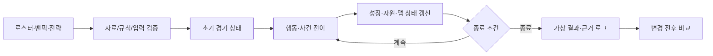

# 모의 밴픽·감독형 시뮬레이션 제품 설계

최신 목표·개발 단계·우선순위의 진입점은 [서비스 메인 문서](PROJECT_MASTER_PLAN.md), 작업 이력은 [개발일지](DEVELOPMENT_LOG.md)다. 이 문서는 기존 상세 설계를 보존하며 미래 기능의 설명을 현재 구현 완료로 해석하지 않는다.

버전 v0.1 · 2026-11-17 · 서비스명 미정

최신 방향 갱신: 특정 팀(T1) 저격 목적을 종료한다. 모든 팀을 동등하게 선택하는
밴픽·로스터·분석 시뮬레이터가 기준이며 [작업 순서](NEXT_WORK_ORDER_2026-11-17.md)를 따른다.

이 문서는 사용자와 합의한 제품 방향과 구현 기준이다. 구현 완료 보고서가 아니다.
사용자는 직접 조작하는 LoL 복제품보다 선수·조합·전략을 시험하는 분석 시뮬레이터를
원한다. 친구·스트리머의 간단한 사용과 감독·분석가의 반복 비교를 함께 지원한다.

## 1. 한 문장 목표

**양 팀과 선수를 고르고 밴픽한 뒤, 근거와 가정을 확인하며 가상 경기 흐름을 비교한다.**

첫 화면은 설명문이나 T1 보고서가 아니라 모의 밴픽 작업 공간이다. 시즌·대회가
끝나도 사용한다. 공식 로스터를 불러올 수 있지만 T1이나 현재 대회에 고정하지 않는다.
장기 목표는 공개 웹에서 이용자를 모으고, 사용성을 유지하면서 광고로 운영비를 충당하는 것이다.

출시 방침 갱신: 한국어·중국어 간체와 핵심 품질 관문을 먼저 충족한다.
현재 개발본은 비공개로 검증하고, 공개 이후 국가별 집계 이용 현황을 바탕으로
서버·도메인 투자를 판단한다. [출시 판단 기준](PRIVATE_RELEASE_READINESS.md)을 따른다.

## 2. 사용자에게 확정된 요구

| 요구 | 제품에서 지킬 기준 |
|---|---|
| 메인은 모의 밴픽 | 홈페이지에서 양 팀 선택과 밴픽을 바로 시작 |
| 양쪽 팀을 자유롭게 선택 | 나/상대 각각 선택; 이후 가상 로스터도 구성 |
| 정보는 선택한 챔피언 중심 | 역할, 근거, 룬·코어 선택지와 적용 조건 |
| 긴 분석은 후순위 | 상세 분석 탭으로 분리 |
| 친구·스트리머도 쉽게 | 첫 단계는 로그인 없는 한 화면 사용, 명확한 턴과 재시작 |
| 감독처럼 반복 실험 | 픽·선수·전략을 바꾸고 변경 전후 결과 비교 |
| 경기처럼 흐름이 있는 시뮬레이션 | 상태 변화와 사건에서 결과가 나오도록 설계 |
| 스토브리그에도 유용 | 선수 교체·역할 배분·챔피언 풀·가상 팀 비교 |
| 개인 전적으로 선수 카드 | 동의한 계정의 관측 성향과 표본을 반영 |
| 웹 공개와 수익화 | 방문·기능 사용·재방문을 계측하고 광고 위치·비용을 관리 |
| 자율 진행 | 합의된 범위는 자동 구현·검증; 계정·비용·공개 범위 결정만 사용자 호출 |

명칭, 도메인, 계정 제공자, 유료 데이터 예산은 미정이다. 아래 기술 선택은 v0.1
권장안이며 실제 접근 범위와 측정 결과에 따라 변경 이유를 기록한다.

## 3. 연중 사용 시나리오

| 시기/사용자 | 질문 | 결과물 |
|---|---|---|
| 시즌 중 감독·분석가 | 이 상대 주력을 밴할까, 열고 다른 카드를 가져갈까? | 교환 후보, 비용, 근거 경기 |
| 국제대회 준비 | 타 리그 성향과 이번 패치가 어떻게 다른가? | 리그·시즌·패치 분리 분석 |
| 대회 종료 후 | 이전 밴픽을 바꾸면 모델 안에서 무엇이 달라지는가? | 과거 시점 복기와 가상 비교 |
| 스토브리그 | 원딜을 교체하면 역할과 챔피언 풀이 어떻게 변하나? | 실제 기록 기반 로스터 차이와 미확인 구간 |
| 친구·스트리머 | 서로 만든 조합으로 가상 경기를 돌려보자 | 밴픽, 관전용 결과, 재도전 |
| 개인 사용자 | 야스오를 자주 쓰는 내 카드가 야스오를 잡으면? | 챔피언 경험별 비교, 표본 부족 표시 |
| 선수 교체 실험 | 나머지 9명을 두고 다이아/마스터 원딜을 바꾸면? | 조건을 고정한 모델 내 차이; 실제 우열 단정 금지 |

스토브리그에는 다음 경기 유무보다 로스터 실험이 중심이다. 이적 루머를 공식
소속으로 등록하지 않는다. 팀명·성적·이름이 비슷하다는 이유로 다른 선수를 합치지 않는다.

## 4. 화면 구조

### 메인: 밴픽

```text
팀/가상 로스터 A       패치·규칙·현재 턴       팀/가상 로스터 B
밴 5칸 · 픽 5칸       챔피언 검색/선택         밴 5칸 · 픽 5칸
                        정보 패널
                  역할 | 룬 | 핵심 코어 | 근거
             되돌리기 · 초기화 · 저장 · 다음 세트
                 [조합 비교] [시뮬레이션]
```

- 상단에 대회 공지·이론·검증 결과를 길게 쌓지 않는다.
- 정보 패널은 현재 선택 중인 챔피언과 확정 픽을 구분한다.
- 처음에는 양 팀 모두 사람이 조작한다. 자동 상대가 없으면 있는 것처럼 표시하지 않는다.
- 표준/피어리스/자유 조합을 구분한다. 자유 실험은 공식 룰 준수 상태와 혼동하지 않는다.
- 양쪽 포지션 배정은 명시 입력이다. 플렉스 픽의 역할은 챔피언 이름만으로 확정하지 않는다.
- 진행 중 팀 교체·되돌리기·다음 세트는 기존 기록과 잠금에 미치는 영향을 표시한다.
- 작은 화면에서도 현재 턴, 선택 확정, 양쪽 픽 현황을 확인할 수 있게 한다.

### 상세 분석

선수·시즌·최근·현재 패치 성향, 리그 비교, 밴 습관, 근거 경기, 자료 시점,
표본과 제외 이유, 평가 결과를 모은다. 선택한 양 팀에 맞지 않는 T1 전용 팩은
일반 팀 분석처럼 적용하지 않는다.

### 로스터 실험

공식 로스터 불러오기 → 기준 날짜 선택 → 포지션별 선수 교체 → 가상 팀으로 저장.
공식 소속, 과거 소속, 사용자 가정을 화면에서 구분한다. 팀을 바꿨다고 기존 팀의
실제 호흡·운영 기록이 새 팀에 그대로 이전되는 것으로 계산하지 않는다.

### 시뮬레이션/비교

입력 확인 → 실행 → 시간 흐름·주요 사건·종료 결과 → 입력 하나 수정 → A/B 비교.
결과 화면에 사용 모델·패치·자료·가정·미지원 요소를 접어 볼 수 있게 제공한다.

## 5. 선수 카드

카드는 선수에게 영구적인 한 줄 평을 붙이는 것이 아니라 관측 자료의 요약이다.

| 항목 | 처리 |
|---|---|
| 정체성 | 출처별 안정 ID와 명시적 연결, 화면용 별명 별도 |
| 소속 | 유효 시작/종료 시점과 출처; 가상 소속은 별도 필드 |
| 포지션 경험 | 큐·기간·상대 수준을 구분한 출전 표본 |
| 챔피언 경험 | 챔피언별 경기 수, 최근 사용, 관측 결과; 숙련도 점수와 분리 |
| 경기 성향 | 관측 가능한 성장·피해·시야·행동 지표를 표본과 함께 제공 |
| 공개 랭크 | 조회 당시 공식 큐/시즌/랭크; 모든 과거 경기 당시 랭크로 소급하지 않음 |
| 자료 없음 | 약한 선수로 처리하지 않고 미확인·대체 기준으로 표시 |
| 심리·감독 능력 | 공개 경기만으로 멘탈·충성도·소통 능력을 임의 추정하지 않음 |

프로 경기와 솔로랭크는 별도 집단이다. 개인 승률·숙련도 포인트·티어를 동일한
숨은 실력 점수로 합치지 않는다. 공식 랭크를 대체하는 MMR/Elo 순위는 만들지 않는다.
경기 시점의 정보만으로 카드를 생성하고 사용한 자료의 버전을 보존한다.

## 6. 룬·아이템과 구도

고정된 '챔피언 정답 빌드'보다 선택 이유와 대안을 제공한다.

| 밴픽 시점에 검토 | 게임 중 상태가 있어야 검토 |
|---|---|
| 양 팀의 피해 구성, 진입/보호 역할, 목표 대상 | 레벨, 남은 골드, 귀환, 실제 적 아이템/방어 능력치 |
| 알려진 상대 챔피언의 CC와 대응 선택 | 다음 오브젝트까지 시간, 점멸/궁극기 등 관측 가능한 상태 |
| 공격/생존 코어의 의도와 비용 | 지금 살 수 있는 하위템과 완성 시점의 교환 비용 |

정보는 관측 빌드 / 선수 발언 / 규칙 기반 가설 / 검증된 추천으로 구분한다.
Knight의 Akali 빌드 발언은 원문·번역·대상 경기·시각을 확보한 뒤 선수 평가로
연결한다. 발언 하나를 보편적인 최적 빌드나 승리 원인으로 확정하지 않는다.
최종 인벤토리는 구매 순서가 아니다. 패치·예산·비교 시점이 다른 빌드를 그대로
비교하지 않는다. 구매·판매·되돌리기·자동 변환이 불명확하면 재고 복원을 중단한다.

## 7. 감독형 시뮬레이터

목표는 선수 성향과 조합에 따라 진행하는 명시적인 모델이다. 초안의 매크로 모델과
게임 내 모든 스킬·위치·충돌을 재현하는 엔진은 구현 범위와 자료 요구가 다르다.



### 입력

양쪽 로스터·포지션·픽, 패치와 맵/규칙, 준비 상태, 확인된 룬/아이템 계획,
운영 가정, 모델/자료 버전, 난수 시드. 시뮬레이션 시작 후 입력 원본은 바꾸지 않는다.

### 상태와 사건

선수별 성장·자원·생존 상태와 팀별 구조물·오브젝트·맵 압박을 관리한다.
사건 후보는 파밍, 귀환, 갱/교전, 오브젝트 시도, 구조물 압박이다. 상세 전투 정보가
없으면 매크로 근사임을 명시한다. 지원하지 않는 효과는 적용된 것처럼 표시하지 않는다.

사건은 직전 상태·행동·룰·모델·난수에서 결정하고 상태를 갱신한다. 승자를 먼저
고른 뒤 그 결과에 맞는 사건·해설을 꾸미지 않는다. 설명 생성 모델은 사건 로그를
읽어 표현할 수 있지만 엔진이 기록하지 않은 이유나 교전을 만들어낼 수 없다.

### 반복 비교

- 동일 입력·모델·자료·시드 → 동일 결과.
- A/B 실험은 공통 시드 묶음과 입력 차이를 저장하고, 임의로 유리한 실행만 고르지 않는다.
- 같은 시드를 썼다는 것만으로 두 경기의 모든 내부 난수가 대응한다고 가정하지 않는다.
- 진영 효과 검사는 좌우를 바꾸되 진영 관련 설정도 함께 변환하고 반복 분포를 비교한다.
- 모델 내 승리 비율과 실제 경기 승리 확률을 구분한다. 반복 횟수를 늘리는 것만으로
  선수 정보 부족이나 모델 편향이 해결되지 않는다.
- 종료 제한에 도달한 실행은 미종료로 남기거나 명시적인 판정 규칙을 별도 적용한다.

## 8. 데이터와 시스템 경계

```text
승인 원본 → 출처별 어댑터 → 시점/정체성/패치 검증 → 버전 고정 특징 자료
                                                      ↓
공개 밴픽 UI ← 공개 집계 자료                    분석/시뮬레이션 엔진
개인 카드 UI ← 본인 동의 자료                         ↓
                                            비교 결과·근거·한계
```

공개 집계, 개인 원본, 모델 설정, 방문 계측은 별도 보관한다. API 키는 브라우저에 넣지
않는다. 단순 브라우저 밴픽은 정적 호스팅으로 가능하지만 계정 연동·비공개 보관·
원격 동시 밴픽·API 중계에는 별도 서버가 필요하다. 구체적 범위는
[API 조사](API_DATA_RESEARCH_2026-11-17.md)와 [공개·계측 계획](ANALYTICS_AND_MONETIZATION.md)에 따른다.

## 9. 단계별 완료 기준

| 단계 | 만드는 것 | 완료 증거 | 지금 막히는 조건 |
|---|---|---|---|
| A | 메인 모의 밴픽·상세 탭 분리 | 양 팀 선택→20수 진행→초기화, 모바일·하위 경로 확인 | UI 구현·자동 검사 진행, 모바일 전체 조작 검증 남음 |
| B | 출처 있는 챔피언/룬/코어 정보 | 패치·출처·자료없음 상태, 관측/추천 구분 | 아이템·룬 작업 범위 검토 |
| C | 날짜별 공식/가상 로스터 | 선수 교체와 과거 소속 보존, 가상 표시 | 공식 이적 자료 연결 |
| D | 개인 성향 카드 | 동의→가져오기→표본 확인→삭제, 비공개 유지 | 허용 API·운영 키/서버 |
| E | 작은 재현 가능 매크로 엔진 | 상태 전이·종료·재현성·자료 부족·A/B 테스트 | 학습/규칙 자료와 적용 범위 결정 |
| F | 공개 베타와 계측 | 실제 방문/완료 지표, 오류·비용 대시보드 | 호스팅·제품 등록·운영 설정 |
| G | 광고 운영 | 계정/사이트 승인, 데이터 상업권, 비가림 광고, 순비용 확인 | 계정·허용 범위·비용 승인 |
| H | 감독용 효용 주장 | 고정 기준의 외부 평가와 미래 시점 재검증 | 사람 평가·자료 성숙·표본 |

기존 사이트는 공개 상태지만 이 표의 새 제품이 완성·재배포됐다는 뜻은 아니다.
개발은 자료 승인과 무관한 A·C의 가상 편집부터 진행할 수 있다. 미지원 엔진이나
추천을 버튼/설명만으로 완료 처리하지 않는다. 시간·예산 견적은 실제 작업 분해 후 정한다.

## 10. 검증 원칙

규칙 안전성, 모델 품질, 사람 효용, 제품 사용성은 서로 다른 검사다.
정확한 예측을 주장할 모델은 같은 시점의 단순 기준선과 비교하고 미래 정보 누출,
팀·선수·리그 차이, 확률 보정, 작은 표본과 실패 사례를 보고한다. 선수 교체 실험은
반사실적 가정이며 실제 교체 효과를 인과적으로 입증한 것으로 표시하지 않는다.
현재 에이전트 예비 평가 점수는 실제 사람에게 유용하다는 근거가 아니다.

## 11. 문서 작성 이후 실행 상태

- 설계 우선 요청으로 진행 중이던 Claude의 제품 코드 구현을 중단했다.
- `worlds-preparation.ts`에 대회 종료/결승 결과 관련 일부 미검증 변경이 남아 있다.
  이를 완료·배포로 간주하지 않으며 다음 구현 시 관련 화면과 테스트를 함께 마무리한다.
- Claude에는 별도 파일 한 개로 현재 기능·데이터 범위 감사를 맡겼다.
- 이후 사용자 지시에 따라 메인 밴픽 UI·상세 탭·챔피언 정보 패널을 구현했다.
  [교차 검토 기록](STAGE_A_CROSS_REVIEW_2026-11-17.md)에서 실제 검사와 남은 항목을 구분한다.
- API/광고/외부 계정 활성화, 새 수집, 커밋·머지·배포는 이번 조사에서 하지 않는다.
- 명칭은 나중에 정한다. 본 문서의 감독형 표현을 공식 서비스명으로 사용하지 않는다.

## 관련 문서

- [조사·설계 문서 안내](DESIGN_RESEARCH_INDEX.md)
- [API와 데이터 제공 범위](API_DATA_RESEARCH_2026-11-17.md)
- [입력·상태·근거 데이터 계약](SIMULATION_DATA_CONTRACT.md)
- [공개·계측·광고 계획](ANALYTICS_AND_MONETIZATION.md)
- [현재 구현/데이터 감사](CURRENT_CAPABILITIES_AUDIT_2026-11-17.md)
